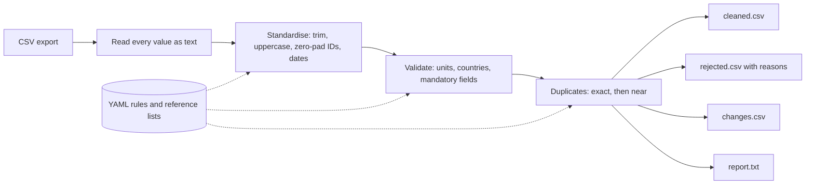

# sap-data-cleaner

A small Python command-line tool that cleans messy SAP-style master data
exports (material master and vendor master CSV files) with pandas. The
cleaning rules live in YAML files, so they can be changed without touching the
code.

> **All data in this repository is synthetic.** The sample files are written by
> a script from invented values. Nothing here comes from a real SAP system or a
> real company. This is a portfolio project and has only been run on that
> synthetic data.

## The problem

Master data that has passed through spreadsheets and several pairs of hands
picks up the same faults again and again:

- material and vendor numbers lose their leading zeros, so `100023` no longer
  matches `000000000000100023`
- the same vendor is created twice as `Zentrix Bearings Pvt Ltd` and
  `Zentrix Bearings Private Limited`
- units arrive as `PCS`, `Nos`, `KGS`, `LTR`; countries as `India`, `DEU`, `UK`
- dates arrive in four different formats in one column
- mandatory fields are blank

Loading such a file into an ERP system either fails row by row or, worse,
succeeds and creates duplicates. This tool sits before the load. It fixes what
can be fixed safely, sets aside what cannot, and says exactly what it did.

## What it does

For one input CSV it writes four files:

| File | Contents |
|------|----------|
| `<name>_cleaned.csv` | Rows that passed, with fixes applied. Same columns as the input. |
| `<name>_rejected.csv` | Rows that failed, exactly as they were in the input, plus `SOURCE_ROW` and `REJECT_REASONS`. |
| `<name>_report.txt` | Plain-text summary: row counts, changes per rule, fills per field, rejects per reason. |
| `<name>_changes.csv` | Audit log: one line per change made to a cleaned row (row, column, old value, new value, rule). |



The rules always run in this order, because validation and duplicate detection
only work on standardised values:

| # | Rule | What it does | If it cannot fix the value |
|---|------|--------------|----------------------------|
| 1 | `trim` | Strips and collapses whitespace; turns `NULL`, `N/A`, `-` into blanks | n/a |
| 2 | `uppercase` | Uppercases the listed code columns | n/a |
| 3 | `zero_pad` | Pads numeric IDs with leading zeros (`MATNR` to 18, `LIFNR` to 10); removes a spreadsheet `.0`; leaves alphanumeric IDs such as `SP-4410` unpadded | rejects IDs that are too long or contain other characters, e.g. `1.00045E+5` |
| 4 | `dates` | Rewrites `DD.MM.YYYY`, `YYYYMMDD`, `DD/MM/YYYY`, `DD-MM-YYYY` as `YYYY-MM-DD`; SAP's initial date `00000000` becomes blank | rejects anything that is not a real date, e.g. `31.02.2023` |
| 5 | `unit_of_measure` | Maps aliases (`PCS`, `ST` to `PC`; `NOS`, `EACH` to `EA`; `KGS` to `KG`) and checks the reference list | rejects unknown units |
| 6 | `country` | Maps aliases (`India`, `IND` to `IN`; `UK` to `GB`) and checks the ISO alpha-2 list | rejects unknown countries |
| 7 | `mandatory` | Per field: fills a blank with a configured default, or rejects the row | reject |
| 8 | `exact_duplicates` | Same key as an earlier row (`MATNR` + `WERKS`, or `LIFNR`). Keeps the first row | later rows are rejected as an exact duplicate, or as a key conflict if their other values differ |
| 9 | `near_duplicates` | Compares names or descriptions after removing case, punctuation, word order and legal forms (`LTD`, `GMBH`). Keeps the first row | later rows are rejected for review with the matching row and score |

Design choices worth knowing:

- **Nothing is merged or deleted.** A duplicate is moved to the rejected file
  with a pointer to the row that was kept. A person decides what happens next.
- **A rejected row lists every problem it has**, not just the first one.
- **Rejected rows are written back untouched**, so they can be corrected at the
  source and run again.
- **Numbers must match for a near-duplicate.** `HEX BOLT M8X20 ZINC PLATED` and
  `HEX BOLT M8X25 ZINC PLATED` score 0.96 on text similarity, above the 0.90
  threshold, and are still two different materials.
- **A material in two plants is not a duplicate**, which is why the plant is
  part of the material key.

## Before and after

These are real rows from the synthetic sample files in
[data/synthetic/](data/synthetic/) and the outputs of an actual run, committed
in [examples/output/](examples/output/). A test fails if those outputs stop
matching what the tool produces.

### Materials: fixed

Before ([data/synthetic/materials.csv](data/synthetic/materials.csv)):

```
MATNR,MAKTX,MTART,MATKL,MEINS,WERKS,BRGEW,GEWEI,ERSDA
100003,HEX NUT M8 ZINC PLATED,roh,FASTENER,pc,1000,0.005,KG,25/07/2020
100005,  BALL BEARING 6204 2RS,ERSA,BEARING,NOS,2000,0.106,KG,2019-05-11
100007.0,V-BELT A42,ERSA,DRIVE,EA,1000,0.150,KG,10/08/2021
000000000000100008,HYDRAULIC OIL ISO VG 46,HIBE,LUBRICANT,L,1000,0.870,,25.03.2021
100030,LIMIT SWITCH ROLLER TYPE,ERSA,ELECTRIC,EA,2000,N/A,,20.10.2019
```

After ([examples/output/materials_cleaned.csv](examples/output/materials_cleaned.csv)):

```
MATNR,MAKTX,MTART,MATKL,MEINS,WERKS,BRGEW,GEWEI,ERSDA
000000000000100003,HEX NUT M8 ZINC PLATED,ROH,FASTENER,PC,1000,0.005,KG,2020-07-25
000000000000100005,BALL BEARING 6204 2RS,ERSA,BEARING,EA,2000,0.106,KG,2019-05-11
000000000000100007,V-BELT A42,ERSA,DRIVE,EA,1000,0.150,KG,2021-08-10
000000000000100008,HYDRAULIC OIL ISO VG 46,HIBE,LUBRICANT,L,1000,0.870,KG,2021-03-25
000000000000100030,LIMIT SWITCH ROLLER TYPE,ERSA,ELECTRIC,EA,2000,,,2019-10-20
```

Leading zeros restored, `roh` and `pc` uppercased, `NOS` mapped to `EA`,
`100007.0` repaired, three date formats unified, a missing weight unit filled
with `KG` because a weight was given, and `N/A` turned into a blank (with no
weight, the weight unit is correctly left blank too).

### Materials: rejected

From [examples/output/materials_rejected.csv](examples/output/materials_rejected.csv)
(first columns shown):

| SOURCE_ROW | REJECT_REASONS | MATNR | MAKTX |
|---|---|---|---|
| 5 | MEINS 'QQ' is not a known unit of measure; MTART is blank | 000000000000100004 | FLAT WASHER M8 STAINLESS |
| 14 | near-duplicate of row 6 (MAKTX similarity 1.00) | 100101 | BEARING BALL 6204 2RS |
| 20 | exact duplicate of row 11 | 100010 | ` lithium grease ep2  ` |
| 22 | same MATNR + WERKS as row 19 but different MEINS | 000000000000100017 | SAFETY HELMET YELLOW |
| 23 | ERSDA '31.02.2023' is not a valid date | 000000000000100019 | CUTTING DISC 4 INCH |
| 32 | MATNR '1.00045E+5' contains characters that are not allowed | 1.00045E+5 | RUBBER GASKET 50MM |
| 39 | near-duplicate of row 9 (MAKTX similarity 0.98) | 100102 | HYDRALIC OIL ISO VG 46 |

Row 20 only becomes an exact duplicate of row 11 once both are standardised:
row 11 is `100010,LITHIUM GREASE EP2,...` and row 20 is the same material typed
in lowercase with stray spaces.

### Vendors: fixed

Before ([data/synthetic/vendors.csv](data/synthetic/vendors.csv)):

```
LIFNR,NAME1,ORT01,PSTLZ,LAND1,STCD1,KTOKK,ZTERM,WAERS,ERDAT
0000200001,Zentrix Bearings Pvt Ltd,Pune   ,411019,in,SYN09510312,ZDOM,NT30,inr,2024-10-06
200002,Kavora Industrial Supplies,Mumbai,400072,India,-,ZDOM,NT45,INR,14.02.2022
200009,Bluepeak Lubricants GmbH,Hamburg,20457,DE,SYN88447167,ZIMP,,EUR,20231101
200016,Quillon Safety Products Inc,Columbus,43215,United States,SYN14665841,ZIMP,,USD,2021-10-15
```

After ([examples/output/vendors_cleaned.csv](examples/output/vendors_cleaned.csv)):

```
LIFNR,NAME1,ORT01,PSTLZ,LAND1,STCD1,KTOKK,ZTERM,WAERS,ERDAT
0000200001,Zentrix Bearings Pvt Ltd,Pune,411019,IN,SYN09510312,ZDOM,NT30,INR,2024-10-06
0000200002,Kavora Industrial Supplies,Mumbai,400072,IN,,ZDOM,NT45,INR,2022-02-14
0000200009,Bluepeak Lubricants GmbH,Hamburg,20457,DE,SYN88447167,ZIMP,0001,EUR,2023-11-01
0000200016,Quillon Safety Products Inc,Columbus,43215,US,SYN14665841,ZIMP,0001,USD,2021-10-15
```

### Vendors: rejected

From [examples/output/vendors_rejected.csv](examples/output/vendors_rejected.csv)
(first columns shown):

| SOURCE_ROW | REJECT_REASONS | LIFNR | NAME1 |
|---|---|---|---|
| 6 | LAND1 'ZZ' is not a known country code; ORT01 is blank | 200005 | Orbita Electricals Pvt Ltd |
| 16 | near-duplicate of row 13 (NAME1 similarity 1.00) | 200103 | Finch & Marlowe Packaging Limited |
| 19 | exact duplicate of row 15 | 200014 | TAMSIN TOOLS INC |
| 21 | near-duplicate of row 2 (NAME1 similarity 1.00) | 200101 | Zentrix Bearings Private Limited |
| 22 | near-duplicate of row 3 (NAME1 similarity 0.98) | 200102 | Kavora Industrial Suplies |
| 27 | same LIFNR as row 25 but different ORT01 | 0000200020 | Colles Aurelienne SAS |
| 32 | LAND1 'Atlantis' is not a known country code | 200024 | Meghna Weld Consumables |

Row 16 is caught against row 13, `Marlowe & Finch Packaging Ltd`: same words in
a different order with a different legal form. `Sundara Steel Traders` appears
twice, once in India and once in the UAE, and both rows are kept because
vendors are only compared within one country.

### The summary report

[examples/output/materials_report.txt](examples/output/materials_report.txt), in full:

```
SAP DATA CLEANER - SUMMARY REPORT
=================================
Input file : data/synthetic/materials.csv
Data type  : material
Rules file : built-in material.yaml
Rules run  : trim, uppercase, zero_pad, dates, unit_of_measure, mandatory, exact_duplicates, near_duplicates

ROWS
  Read         38
  Cleaned      25
  Rejected     13

CHANGES MADE TO CLEANED ROWS, BY RULE
  trim                 6
  uppercase            6
  zero_pad            13
  dates               17
  unit_of_measure     10
  mandatory            5
  Total               57
  Rejected rows are written back unchanged, so changes to them are not counted.

BLANK VALUES FILLED WITH A DEFAULT, BY FIELD
  GEWEI      3
  MATKL      2

REJECTED ROWS, BY REASON
  near-duplicate                        3
  exact duplicate                       2
  invalid date in ERSDA                 2
  unknown unit of measure in MEINS      2
  invalid MATNR                         1
  key conflict                          1
  missing mandatory field MAKTX         1
  missing mandatory field MEINS         1
  missing mandatory field MTART         1
  A row with several problems is counted once under each reason.

EXAMPLES OF CHANGES (first one per rule)
  row 2    MATNR  '100001' -> '000000000000100001'  (zero_pad)
  row 2    ERSDA  '13.04.2019' -> '2019-04-13'  (dates)
  row 4    MTART  'roh' -> 'ROH'  (uppercase)
  row 4    MEINS  'pc' -> 'PC'  (unit_of_measure)
  row 6    MAKTX  '  BALL BEARING 6204 2RS' -> 'BALL BEARING 6204 2RS'  (trim)
  row 9    GEWEI  '' -> 'KG'  (mandatory)
```

The vendor run read 31 rows, cleaned 18 and rejected 13
([vendors_report.txt](examples/output/vendors_report.txt)). The sample files are
deliberately dirty, which is why so many rows are rejected. These counts
describe the synthetic samples only and say nothing about how real data would
behave.

## Install

Needs Python 3.11 or newer (pandas 3 does not support older versions).
Tested on Python 3.11.9 on Windows 11.

```
git clone <repository-url>
cd sap-data-cleaner
python -m venv .venv
```

Activate the environment:

```
.venv\Scripts\activate          # Windows
source .venv/bin/activate       # macOS / Linux
```

Then install the pinned dependencies (pandas, PyYAML, pytest):

```
pip install -r requirements.txt
```

## Usage

Clean the sample files:

```
python -m sap_cleaner clean --input data/synthetic/materials.csv --type material --out out/
python -m sap_cleaner clean --input data/synthetic/vendors.csv --type vendor --out out/
```

The first command prints:

```
Read 38 rows from data/synthetic/materials.csv (material)
  cleaned     25 rows  -> out/materials_cleaned.csv
  rejected    13 rows  -> out/materials_rejected.csv
  changes     57 lines -> out/materials_changes.csv
  report               -> out/materials_report.txt
```

Options:

| Option | Default | Purpose |
|--------|---------|---------|
| `--input` | required | CSV file to clean |
| `--type` | required | `material` or `vendor` |
| `--out` | required | Output directory, created if missing |
| `--config` | built-in rules | A rules YAML to use instead |
| `--delimiter` | `,` | Field separator, e.g. `";"`. Use `"\t"` for tab |
| `--encoding` | `utf-8-sig` | Input encoding, e.g. `cp1252` |

Exit codes: `0` the run finished (rejected rows are a normal result, not an
error), `1` the input file is missing, unreadable or lacks a required column,
`2` the command or the rules file is wrong.

`SOURCE_ROW` is the row number as a spreadsheet shows it: the header is row 1
and the first data row is row 2.

To regenerate the synthetic sample data (the seed is fixed, so the files come
out identical):

```
python scripts/generate_sample_data.py
```

## Changing the rules

Each data type has one rules file:
[sap_cleaner/config/material.yaml](sap_cleaner/config/material.yaml) and
[sap_cleaner/config/vendor.yaml](sap_cleaner/config/vendor.yaml). The unit and
country lists are in
[sap_cleaner/config/reference.yaml](sap_cleaner/config/reference.yaml).

Edit those files, or copy one and pass it with `--config`. A few things that
need no code change:

```yaml
rules:
  dates:
    output_format: "%Y%m%d"          # SAP's internal date format instead of ISO

  mandatory:
    fields:
      ZTERM: {action: fill, value: "0001"}   # fill a blank with a default
      KTOKK: {action: reject}                # or reject the row

  near_duplicates:
    threshold: 0.85                  # catch looser matches
    action: flag                     # keep them, add a NEAR_DUPLICATE_NOTE column

  zero_pad:
    enabled: false                   # switch a rule off
```

The rules file is checked before anything runs. A misspelt rule name, an
unknown setting or a column that does not exist stops the run with a message
such as `Config error: unknown rule 'trimm'` instead of silently skipping the
rule.

Two YAML traps the loader guards against: an unquoted `0001` is the number 1,
and an unquoted `NO` (Norway) is `false`. Fill values and reference entries
must be quoted strings, and the loader says so if they are not.

## Tests

```
python -m pytest
```

153 tests pass on Python 3.11.9 with the pinned dependencies. There is a test
module for each rule, plus config, pipeline and report tests.

The end-to-end test ([tests/test_cli_e2e.py](tests/test_cli_e2e.py)) generates
the sample data with the real script, runs the real CLI as a subprocess, and
checks the result against what the generator injected, recorded in
[manifest.json](data/synthetic/manifest.json):

- exactly the rows with an injected reject defect are rejected, each with the
  expected reason
- look-alike rows that are not duplicates survive
- every difference between input and cleaned file is explained by the change log
- cleaning the cleaned file again changes nothing and rejects nothing

## Why this relates to SAP MM data quality

Materials Management runs on master data. Purchase orders, goods receipts,
stock and invoice verification all read the material master and the vendor
master, so a fault in either is repeated in every document that uses it. The
rules here mirror checks that matter in that setting:

- **Leading zeros.** SAP stores numeric material and vendor numbers padded with
  zeros (18 characters for a classic material number, 10 for a vendor) and hides
  the zeros on screen. A spreadsheet strips them. A file that compares or
  uploads the short form as plain text will not find the record.
- **Units of measure.** The base unit (`MEINS`) drives quantities in stock and
  purchasing. `PCS`, `ST` and `PC` meaning the same thing is harmless to a
  person and a hard error to a system, and a unit that does not exist blocks
  the record.
- **Duplicate vendors and materials.** Two numbers for one vendor split the
  purchasing history and open items; two numbers for one material split the
  stock. They are easy to create and hard to remove once documents exist, so
  catching them before the load is far cheaper.
- **Mandatory fields.** A material without a type or base unit, or a vendor
  without a country or account group, cannot be created at all.
- **Dates and countries.** SAP's internal date format is `YYYYMMDD` and country
  keys are two-letter codes; exports and hand-maintained files rarely agree.

The column names follow SAP's field names (`MATNR`, `MAKTX`, `MTART`, `MATKL`,
`MEINS`, `WERKS` for materials; `LIFNR`, `NAME1`, `ORT01`, `LAND1`, `KTOKK`,
`ZTERM` for vendors), but the layout is a simplified flat file. A real material
master is spread over many tables and views, and in S/4HANA a vendor is a
business partner. This tool is a pre-load cleaning step for flat files, not a
model of SAP.

## Limitations

- **Only run on synthetic data.** It has not been tried on an export from a real
  SAP system, where there will be cases the sample data does not contain.
- **Flat CSV only.** No connection to SAP, no upload, no Excel files. The whole
  file is read into memory.
- **Simplified schema.** One flat file per object with a handful of fields.
- **Only units and countries are validated against a list**, and those lists
  are small subsets (20 units, 45 countries). Material types, plants, account
  groups, payment terms and currencies are not checked.
- **Numeric fields are not checked.** A weight of `abc` or `1,5` passes through.
- **Dates are read day-first from a fixed list of formats.** A US-style
  `03/04/2024` is read as 3 April without warning. Two-digit years are rejected.
- **Near-duplicate matching is plain text similarity.** It does not understand
  abbreviations (`BRG` for `BEARING`), synonyms or translations. Legal forms are
  only ignored when written as one word, so `G.m.b.H` is not recognised as
  `GmbH`. It only compares rows inside one block (same country, or same
  material type), so a duplicate vendor entered under the wrong country is
  missed.
- **The first occurrence is always the one kept**, with no check of which record
  is better. For a key conflict the first row may be the wrong one. The rejected
  file names both rows so a person can decide.
- **Near-duplicate checking compares each row with the rows kept so far in its
  block**, so the work grows quickly with file size. No performance
  measurements have been made.
- **The default fill values are examples** (`UNCLASS`, `KG`, `0001`), not
  recommendations.
- **Row numbers assume one record per line.** A quoted field containing a line
  break shifts the numbering.
- **Output is always UTF-8**, whatever the input encoding. The automated tests
  cover comma and semicolon separated UTF-8 input; a tab-separated `cp1252`
  file was only checked by hand.

## Project layout

```
sap_cleaner/
  cli.py            argparse, exit codes, writes the output files
  config.py         loads and validates the YAML rules
  pipeline.py       reads the CSV, runs the rules in order, builds the tables
  runlog.py         records every change and reject reason
  report.py         builds the text summary
  rules/            standardise, dates, reference, mandatory, duplicates
  config/           material.yaml, vendor.yaml, reference.yaml
scripts/generate_sample_data.py
data/synthetic/     synthetic sample input and the generator's manifest
examples/output/    outputs of a real run on the sample data
tests/
```

## License

MIT. See [LICENSE](LICENSE).
